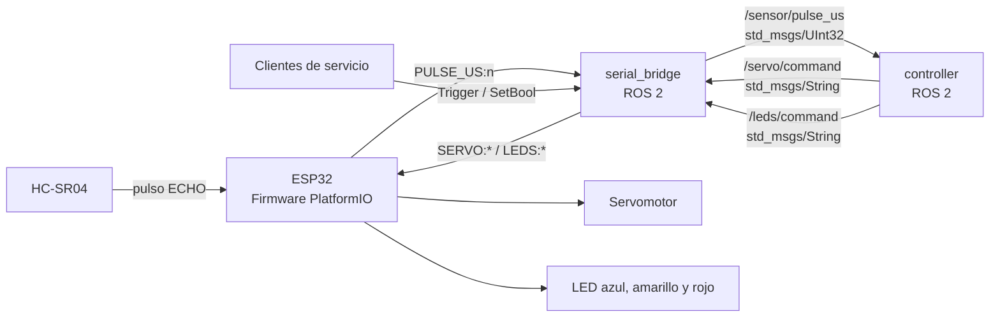
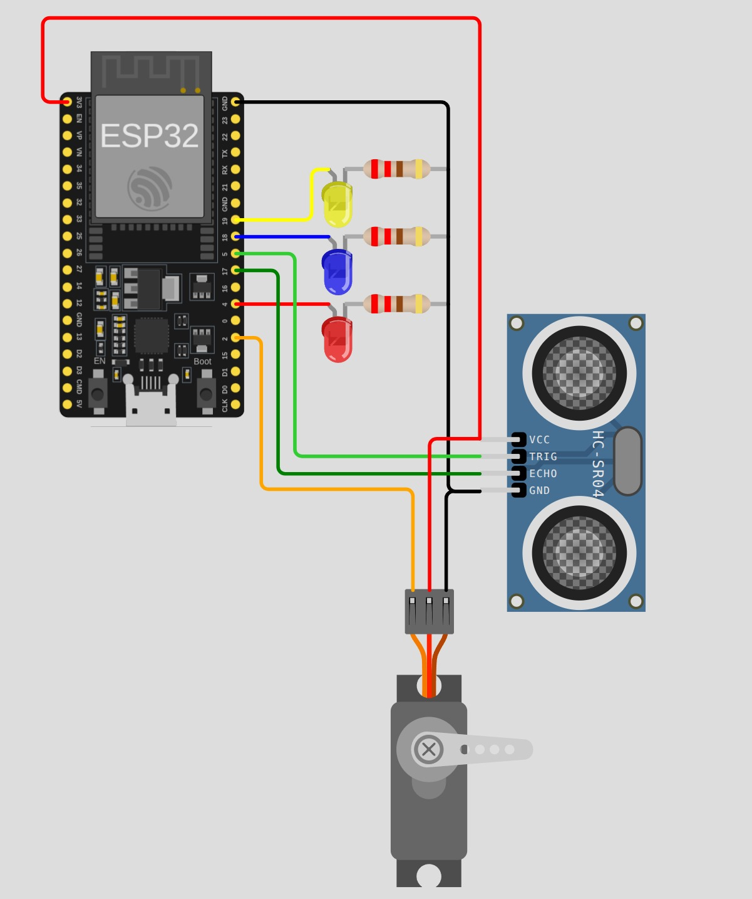

# Taller: comunicaciones entre ROS 2 y un ESP32

## Objetivo

Construir un sistema distribuido sencillo en el que el ESP32 se ocupa de leer
el hardware y ejecutar órdenes, mientras ROS 2 interpreta la medición y decide
qué debe hacer el robot. Al terminar el taller podrán explicar cuándo conviene
usar comunicación publicador/suscriptor y cuándo una comunicación
cliente/servicio.

El repositorio contiene una base funcional con varias secciones marcadas como
`TODO`. El propósito es completar las interfaces ROS 2 y la lógica de control,
no reemplazar el protocolo serial existente.

## Arquitectura del sistema



La separación es intencional:

- `tallerj1/` contiene el proyecto de PlatformIO y el firmware del ESP32.
- `serial_bridge.py` traduce entre el puerto serial y ROS 2; no decide el
  comportamiento del robot.
- `controller.py` contiene la lógica de decisión; no accede directamente al
  puerto serial.
- `taller.launch.py` inicia los dos nodos y les entrega su configuración.

## Estructura del repositorio

```text
ROS2communications/
├── tallerj1/                         # Proyecto PlatformIO
│   ├── platformio.ini                # Placa, framework y dependencias
│   └── src/main.cpp                  # Firmware del ESP32
└── tallerj1_ros/                     # Paquete Python de ROS 2
    ├── launch/taller.launch.py       # Arranque del sistema
    ├── tallerj1_ros/controller.py    # Lógica del robot
    └── tallerj1_ros/serial_bridge.py # Puente serial ↔ ROS 2
```

## Hardware y conexiones

- ESP32 AZ-Delivery DevKit V4.
- Sensor ultrasónico HC-SR04.
- Un servomotor compatible con `ESP32Servo`.
- LED azul, amarillo y rojo, cada uno con una resistencia de 220 Ω
  a 330 Ω.
- Divisor de tensión para la señal `ECHO` del HC-SR04.
- Fuente de 5 V apropiada para el servomotor.




### Pines usados

| Elemento | Conexión en el ESP32 |
|---|---:|
| Servomotor, señal | GPIO 2 |
| HC-SR04 `TRIG` | GPIO 5 |
| HC-SR04 `ECHO` | GPIO 17, mediante divisor de tensión |
| LED azul | GPIO 18 |
| LED amarillo | GPIO 19 |
| LED rojo | GPIO 4 |
| Tierras | GND común |

> **Atención:** el firmware incluido define `PIN_SERVO = 2`. Si se utiliza un
> diagrama previo que muestre la señal del servo en GPIO 15, hay que mover el
> cable a GPIO 2 o modificar la constante en `main.cpp`; no deben mezclarse las
> dos configuraciones.

### Precauciones eléctricas

- No conecten directamente `ECHO` del HC-SR04 al ESP32 cuando el sensor está
  alimentado a 5 V: el ESP32 trabaja con lógica de 3,3 V. Usen un divisor de
  tensión o un conversor de nivel.
- Es preferible alimentar el servo con una fuente externa de 5 V. No usen el
  pin de 3,3 V para alimentarlo.
- La fuente del servo, el HC-SR04 y el ESP32 deben compartir GND.
- Comprueben el orden de los cables del servo. Los colores varían entre
  fabricantes; normalmente rojo es alimentación, negro/café es GND y
  naranja/amarillo es señal.

## Comportamiento requerido

1. Sin obstáculo, el LED azul permanece encendido y el servomotor hace un
   barrido continuo por todo su rango seguro de movimiento.
2. Con un obstáculo a más de 5 cm y hasta 20 cm, el LED amarillo titila cada
   400 ms y el servomotor hace un barrido continuo por la mitad de su rango.
3. Con un obstáculo a más de 0 cm y hasta 5 cm, el LED rojo permanece encendido
   y el servomotor deja de moverse, conservando su última posición.
4. Los otros LED deben permanecer apagados en cada estado.
5. Deben existir servicios para ordenar barrido completo, medio barrido y
   detención del servo, además de encender o apagar cada LED por separado.

La decisión basada en distancia debe vivir en `controller.py`. El firmware
solo mide, reporta y ejecuta órdenes.

## Contrato de comunicación propuesto

Para que ambos nodos sean compatibles, se recomienda conservar exactamente
estos nombres y tipos al completar los `TODO`:

| Interfaz ROS 2 | Tipo | Origen → destino | Contenido |
|---|---|---|---|
| `/sensor/pulse_us` | `std_msgs/msg/UInt32` | bridge → controller | Duración del eco en microsegundos |
| `/servo/command` | `std_msgs/msg/String` | controller → bridge | `FULL_ROTATION`, `HALF_ROTATION` o `STOP` |
| `/leds/command` | `std_msgs/msg/String` | controller → bridge | `azul,amarillo,rojo`; por ejemplo, `1,0,0` |
| `/servo/full_rotation` | `std_srvs/srv/Trigger` | cliente → bridge | Inicia el barrido completo |
| `/servo/half_rotation` | `std_srvs/srv/Trigger` | cliente → bridge | Inicia el medio barrido |
| `/servo/stop` | `std_srvs/srv/Trigger` | cliente → bridge | Conserva el último ángulo |
| `/leds/blue` | `std_srvs/srv/SetBool` | cliente → bridge | Enciende/apaga el LED azul |
| `/leds/yellow` | `std_srvs/srv/SetBool` | cliente → bridge | Enciende/apaga el LED amarillo |
| `/leds/red` | `std_srvs/srv/SetBool` | cliente → bridge | Enciende/apaga el LED rojo |

Los tópicos son adecuados para el flujo continuo de mediciones y órdenes. Los
servicios son adecuados para acciones solicitadas bajo demanda porque devuelven
una respuesta con `success` y `message` al cliente.

### Protocolo serial

El puerto trabaja a **115200 baudios** y cada mensaje termina en salto de línea.

| Dirección | Formato | Ejemplo |
|---|---|---|
| ESP32 → ROS 2 | `PULSE_US:<entero>` | `PULSE_US:1166` |
| ROS 2 → ESP32 | `SERVO:<modo>` | `SERVO:FULL_ROTATION` |
| ROS 2 → ESP32 | `LEDS:<azul>,<amarillo>,<rojo>` | `LEDS:0,1,0` |

No agreguen texto de depuración arbitrario a este protocolo sin adaptar el
puente. `serial_bridge.py` ignora las líneas que no comienzan con `PULSE_US:`.

## Qué hay y qué se debe implementar

### Proyecto PlatformIO: `tallerj1/`

`platformio.ini` ya selecciona la placa AZ-Delivery DevKit V4, Arduino como
framework, 115200 baudios y la dependencia `ESP32Servo`. `src/main.cpp` ya
incluye:

- configuración de pines;
- lectura periódica del HC-SR04;
- envío de `PULSE_US` por serial;
- recepción y validación básica de comandos para el servo y los LED;
- barrido no bloqueante del servo;
- un *watchdog* de comandos: tras 1500 ms sin una orden válida para el servo,
  detiene el barrido y conserva la última posición.

El firmware puede modificarse para calibrar ángulos, intervalos o pines, pero no
debe incorporar la lógica de distancia del robot. Eviten `delay()` prolongados:
bloquearían la lectura serial, el sensor y la actualización del servo.

### Puente: `serial_bridge.py`

Este nodo debe completar las interfaces ROS 2 indicadas en la tabla anterior:

1. Crear el publicador de `/sensor/pulse_us`.
2. Crear suscriptores para `/servo/command` y `/leds/command`.
3. Publicar el `UInt32` después de convertir una línea `PULSE_US` válida.
4. Traducir los comandos recibidos al protocolo serial.
5. Crear los seis servicios y llenar siempre `response.success` y
   `response.message`.
6. Mantener el estado de los tres LED para que cambiar uno mediante `SetBool`
   no modifique los otros dos.

El nodo ya detecta `/dev/ttyUSB*` y `/dev/ttyACM*`, permite elegir el puerto con
el parámetro `port` y cierra el dispositivo al terminar. Aquí no deben aparecer
los umbrales de distancia ni la lógica de parpadeo.

### Controlador: `controller.py`

Este nodo debe:

1. Suscribirse a `/sensor/pulse_us`.
2. Crear publicadores para `/servo/command` y `/leds/command`.
3. Convertir el tiempo de vuelo a distancia. Para aire a temperatura ambiente:

   ```text
   distancia_cm = pulso_us × 0.0343 / 2
   ```

   Se divide entre dos porque el sonido recorre la distancia de ida y vuelta.
   Una lectura de `0` significa que no se recibió eco antes del *timeout* y
   debe tratarse como “sin obstáculo”.

4. Implementar los tres intervalos del comportamiento requerido.
5. Activar `warning_active` únicamente en la zona amarilla. El temporizador ya
   creado invierte el LED cada 400 ms.
6. Publicar estados completos de los LED para garantizar que los no usados
   queden apagados.

Conviene detectar cambios de estado para evitar mensajes de registro repetidos,
aunque se deben reenviar las órdenes del servo con suficiente frecuencia para
mantener activo el mecanismo de seguridad de 1500 ms del firmware.

### Lanzamiento: `taller.launch.py`

El archivo ya declara el argumento `port`, inicia `serial_bridge` y
`controller`, y muestra su salida en la terminal. Para agregar parámetros en el
futuro —por ejemplo, `baudrate` o umbrales— deben declararse como argumentos y
pasarse al nodo correspondiente en `parameters`.

El *launch* funciona después de que `setup.py` instale tanto los ejecutables
como el archivo ubicado en `launch/`. Después de modificarlo, reconstruyan el
paquete o usen `--symlink-install` durante el desarrollo.

## Preparación

Se requiere ROS 2 Jazzy, PlatformIO y acceso al puerto serial:

```bash
sudo apt install python3-serial
cd /ruta/a/tallerj1_ws
source /opt/ros/jazzy/setup.bash
rosdep install --from-paths src --ignore-src -r -y
colcon build --packages-select tallerj1_ros --symlink-install
source install/setup.bash
```

Si aparece “permission denied” al abrir el puerto, agreguen el usuario al grupo
`dialout`, cierren sesión y vuelvan a entrar:

```bash
sudo usermod -aG dialout "$USER"
```

## Compilar y cargar el firmware

Desde la raíz del workspace:

```bash
cd src/ROS2communications/tallerj1
pio run
pio run --target upload
```

Para una prueba aislada se puede ejecutar `pio device monitor`, pero hay que
cerrarlo antes de iniciar el puente: solo un proceso puede usar el puerto serial
a la vez.

## Ejecución

Conecten el ESP32 y, desde la raíz del workspace, ejecuten:

```bash
source /opt/ros/jazzy/setup.bash
source install/setup.bash
ros2 launch tallerj1_ros taller.launch.py
```

El puente selecciona automáticamente el primer dispositivo `/dev/ttyUSB*` o
`/dev/ttyACM*`. Si hay varios conectados, indiquen uno explícitamente:

```bash
ros2 launch tallerj1_ros taller.launch.py port:=/dev/ttyUSB0
```

## Pruebas y diagnóstico

En terminales que hayan cargado los dos archivos `setup.bash`:

```bash
# Verificar nodos, tópicos y servicios
ros2 node list
ros2 topic list
ros2 service list

# Observar la señal cruda y su frecuencia
ros2 topic echo /sensor/pulse_us
ros2 topic hz /sensor/pulse_us

# Probar los tópicos sin el controlador
ros2 topic pub --once /servo/command std_msgs/msg/String "{data: STOP}"
ros2 topic pub --once /leds/command std_msgs/msg/String "{data: '1,0,0'}"

# Probar servicios
ros2 service call /servo/full_rotation std_srvs/srv/Trigger "{}"
ros2 service call /leds/blue std_srvs/srv/SetBool "{data: true}"
```

### Problemas frecuentes

| Síntoma | Posible causa / comprobación |
|---|---|
| No se encuentra el ESP32 | Revisar cable USB, dispositivos y argumento `port` |
| Permiso denegado | Comprobar pertenencia al grupo `dialout` |
| Puerto ocupado | Cerrar PlatformIO Serial Monitor u otro programa serial |
| Lecturas siempre en cero | Revisar `TRIG`, `ECHO`, GND, alimentación y orientación del sensor |
| El ESP32 se reinicia al mover el servo | Usar una fuente de 5 V adecuada y GND común |
| El servo se detiene al poco tiempo | El watchdog no recibió otra orden válida durante 1500 ms |
| Los cambios Python no aparecen | Reconstruir con `--symlink-install` y recargar `install/setup.bash` |

## Orden de implementación sugerido

1. Cargar el firmware y comprobar que aparecen líneas `PULSE_US`.
2. Completar únicamente la publicación del sensor en `serial_bridge.py` y
   verificarla con `ros2 topic echo`.
3. Completar publicadores y suscriptores de comandos; probarlos manualmente.
4. Implementar la conversión y los tres estados en `controller.py`.
5. Implementar los servicios y probar cada uno por separado.
6. Ejecutar todo con el archivo *launch* y probar los límites de 5 cm y 20 cm.

## Preguntas para entregar

1. Escriban la ecuación usada para convertir microsegundos a centímetros.
2. ¿Por qué el sensor es un buen candidato para publicador/suscriptor?
3. ¿Qué confirmación recibe un cliente de servicio que no recibe quien publica
   en un tópico?
4. ¿Qué pasa si ROS 2 se cierra mientras el servo está moviéndose? Identifiquen
   la protección incluida en el firmware.
5. Muestren con `ros2 topic echo` que los tiempos cambian al mover un objeto.
